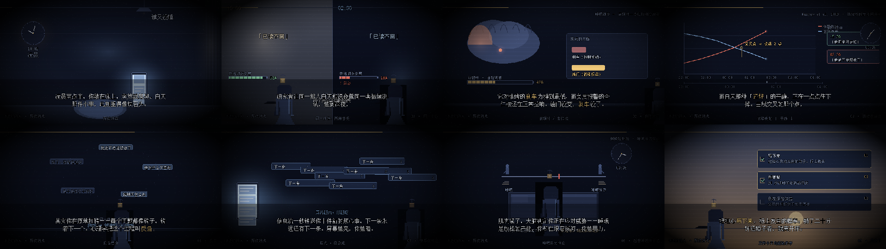

# 深夜效应 · Late-Night Effect

> 一到凌晨你就想哭，不是矫情，是刹车没了。

一支 **1920×1080 / 30fps / 2 分 57 秒** 的像素科普短片。
从选题调研、文案定稿、视觉设计到配乐混音，**全流程程序化生成**，没有一张外部素材。

**成片**：[`out/night01_late_night_emo.mp4`](out/night01_late_night_emo.mp4)（也在 Release 里）



---

## 它讲什么

同一个人，下午三点看到「已读不回」耸耸肩就过去了；凌晨两点半再看到，整个人都塌了。
事情没变，变的是大脑：

1. **刹车没了** —— 前额叶管"忍住别冲动"，消耗一整天后对情绪的抑制力掉到最低，而杏仁核还在正常报警
2. **情绪夜曲线** —— 情绪唤起的强度随时间上升，白天那种"还好"的平静在下行，两条线在凌晨两点前后交叉
3. **反刍启动** —— 安静下来，脑子把同一件事翻回来，每个问题都像钩子钩着下一个
4. **屏幕加柴** —— 蓝光压住褪黑素，信息流一秒送你十件新的烦心事
5. **睡眠努力悖论** —— 越想睡越焦虑，睡眠是放松的产物，你却在跟它拔河

结尾给三件今天就能做的事：写下来 / 20 分钟睡不着就离开床 / 别在凌晨三点做决定。

---

## 技术栈

| 环节 | 做法 |
|---|---|
| 画面 | Python + pygame-ce 在 **640×360 虚拟画布**上 1:1 像素绘制，逐帧通过 rawvideo 管道交给 ffmpeg |
| 放大 | ffmpeg `scale=1920:1080:flags=neighbor`（最近邻，保住像素颗粒） |
| 编码 | libx264 CRF18 / yuv420p / AAC 192k / `+faststart` |
| 配音 | 阿里云百炼「千问」`qwen3-tts-flash`（音色 Cherry）；无密钥时自动降级 edge-tts → gTTS → Windows 本地语音 |
| 配乐 | 程序化合成：70 BPM，A 小调起步末段转 C 大调，8 段编排（pad / piano / sub bass / 黑胶底噪） |
| 音效 | 全部 numpy 合成，无采样文件 |
| 角色 | 纯几何骨架绘制（26×52 像素 × 4x），三档亮度位图交叉混合 |
| 时长控制 | **画面节奏由配音时长反推**，改文案自动重排时间轴 |

---

## 复现

```powershell
# 依赖（本机 Python 3.14.6）
python -m pip install pygame-ce numpy scipy pillow imageio-ffmpeg requests edge-tts gTTS

# 配音密钥（二选一；不给会自动降级到免费引擎）
#   a) 环境变量 DASHSCOPE_API_KEY / DASHSCOPE_BASE_URL
#   b) .cache/aliyun.json  {"api_key": "...", "base_url": "https://ws-xxx.maas.aliyuncs.com/api/v1"}

python build_night.py --stills    # 关键帧自检（几秒）
python build_night.py --no-tts    # 看运动与转场
python build_night.py             # 完整出片（本机约 155 秒）
python tools/night_report.py      # 8 条交付判据验收
```

改成你自己的选题：只需要改 `nightpix/night_ep.py` 里的 `NARRATION` 文案，
以及 `nightpix/scenes.py` 里的 8 个场景函数。

---

## 目录

```
night_emo/
├─ nightpix/            引擎
│  ├─ config.py         画布/调色板/字体
│  ├─ pixeltext.py      像素字: 无抗锯齿 + 描边 + 折行 + 居中混色
│  ├─ paint.py          渐变/光晕/光池/暗角/颗粒/雨丝/星空/转场/版式
│  ├─ keeper.py         角色「提灯的人」
│  ├─ props.py          道具: 床/手机/时钟/脑剖面/折线图/卡片/拔河
│  ├─ scenes.py         8 场分镜
│  ├─ night_ep.py       时间轴 + 文案 + 混音
│  ├─ tts.py            六引擎旁白降级链
│  ├─ audio.py          合成音效 + 环境声 + 总线压缩
│  ├─ music.py          分段配乐引擎 + night_song
│  └─ render.py         逐帧 → ffmpeg
├─ build_night.py       构建入口
├─ tools/               定稿与验收工具
├─ docs/                制作过程 / 形象设计
└─ out/                 成片、混音、发布文案
```

---

## 过程文档（值得一读的部分）

制作过程没有只留结果 —— 被推翻的设计、踩过的坑、每一版的取舍理由都在里面：

- [`docs/process.md`](docs/process.md) —— 制作全过程
  - 选题筛选与实证来源
  - **时长账**：怎么从 5.1 字/秒反推出 757 字的目标文案（第一版 650 字差 19 秒）
  - **被推翻的设计**：角色做了 4 版（剪影色被夜色吃掉 / 正面空白脸恐怖谷 / …）
  - **被推翻的设计**：光锥从多边形改成椭圆光池
  - **成片 316MB 事故**：胶片颗粒把 x264 码率拉爆的排查与修复
- [`docs/design.md`](docs/design.md) —— 形象设计说明（骨架行号表 / 灯的语义 / 三档亮度混合）

---

## 许可

代码 MIT。片中旁白与画面均为本项目程序化生成，可自由使用与改编；
文末列出的学术来源仅作事实引用。
